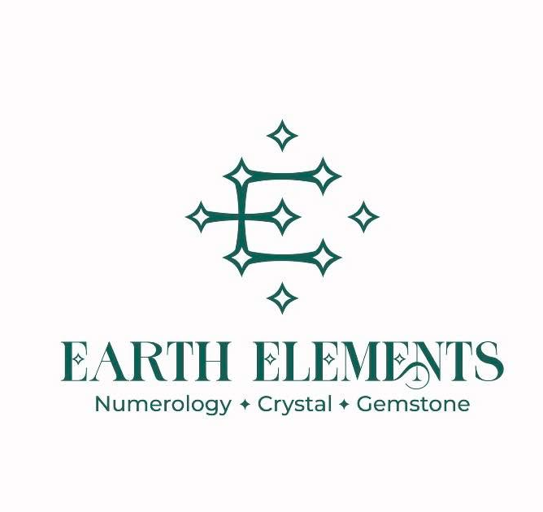

<div align="center">



# 🌿 Earth Elements × MADS Case Study

### Google Business Profile • Google Ads Assistance • Instagram & Facebook Linking

**Client:** Earth Elements (Numerology • Crystal • Gemstone)  
**Service Provider:** MADS — Metro Ad Services | SNTL 84 | desidevloper.com  
**Location:** India (Google Maps optimized)  
**Package Value:** ₹3,500 (one-time setup)  
**Timeline:** 3 days (including verification + post-assistance)

[](https://wa.me/919727413309)
[](https://desidevloper.com)
[](https://linkedin.com/in/sntl2784)
[](https://github.com/SNTL84)
[](https://www.instagram.com/desibiztrade)
[](LICENSE)
[](https://github.com/SNTL84)

**We Market. You Grow.** · Local discovery → Social conversion → Real customers

</div>

---

## 📑 Table of Contents

- [Project Overview](#-project-overview)
- [Brand Assets](#-brand-assets)
- [What We Delivered](#-what-we-delivered)
- [Live Business Links](#-live-business-links)
- [Delivery Timeline & Fee](#-delivery-timeline--fee)
- [Why This Matters for Crystal & Numerology Businesses](#-why-this-matters-for-crystal--numerology-businesses)
- [How Customers Discover & Convert](#-how-customers-discover--convert)
- [FAQ](#-faq)
- [Why Clients Choose MADS / SNTL 84](#-why-clients-choose-mads--sntl-84)
- [Services We Offer](#-services-we-offer)
- [Repository Structure](#-repository-structure)
- [High-Relevance Topics](#-high-relevance-topics)
- [Contact & Next Steps](#-contact--next-steps)

---

## 🎯 Project Overview

Earth Elements trusted **MADS (Metro Ad Services)** and **SNTL 84** for a focused, high-impact visibility package:

- ✅ **Google Business Profile** creation & optimization so the business appears correctly on Google Maps and local search
- ✅ **Google Ads setup assistance** so paid campaigns (when ready) start from a clean, verified foundation
- ✅ **Instagram + Facebook** profiles linked and prepared for faster customer conversion
- ✅ **Post-setup support** through verification and initial visibility checks

The goal was simple and measurable: **be found on Google Maps** and **convert that discovery into conversations** via the social channels customers already use.

> No invented metrics. No fake testimonials. Just the work that was delivered in 3 days for ₹3,500.

---

## 🖼️ Brand Assets

Official brand assets used in this engagement and committed to the repository for transparency.

| Earth Elements Logo | MADS Branding |
|:-------------------:|:-------------:|
|  |  |
| Numerology • Crystal • Gemstone | We Market. You Grow. |

| SNTL 84 Professional Presence | MADS Social Engagement Creative |
|:-----------------------------:|:-------------------------------:|
|  |  |
| Founder & Agentic AI Workflow Professional | Strategy • Creativity • Growth |

Additional assets in `/assets`:

- `mads-cycle.jpg` — MADS Cycle Ads identity
- `sntl84-logo.png` — SNTL 84 sized brand mark

---

## ✅ What We Delivered

### 1. Google Business Profile (Maps Visibility)

- Assisted creation of a verified Google Business Profile
- Correct category, description, contact details, and service area configuration
- Optimization so the business can be located accurately on Google Maps
- Guidance through the verification process

### 2. Google Ads Foundation

- Assisted setup of Google Ads account structure linked to the new Business Profile
- Best-practice recommendations for local campaigns (no mandatory spend forced)
- Clean foundation so future paid campaigns start correctly

### 3. Social Profiles for Conversion

- Instagram Business profile prepared and linked: [@earth_elements369](https://www.instagram.com/earth_elements369/)
- Facebook profile / page prepared and linked
- Cross-linking so visitors from Google can quickly move to social proof and messaging

### 4. Post-Assistance & Visibility Checks

- Support through the 3-day setup window
- Verification follow-up
- Final checks for complete business visibility

**Result:** A local crystal & numerology business that is now discoverable on Google Maps with clear paths to Instagram and Facebook for customer conversion.

---

## 🔗 Live Business Links

| Platform | Link | Purpose |
|----------|------|---------|
| **Google Business / Maps** | [Open Google share](https://share.google/ei6O8aKMlg3SbxWK8) | Local discovery & reviews |
| **Instagram** | [instagram.com/earth_elements369](https://www.instagram.com/earth_elements369/) | Visual catalog, stories, DMs |
| **Facebook** | [Facebook Profile](https://www.facebook.com/profile.php?id=61581033450714) | Social proof & messaging |

These links were added and prepared during the engagement specifically to speed up the path from search → profile → conversation.

---

## ⏱️ Delivery Timeline & Fee

| Item | Detail |
|------|--------|
| **Setup Fee** | ₹3,500 (one-time) |
| **Duration** | 3 days |
| **Includes** | Google Business Profile setup + verification support, Google Ads assistance, Instagram & Facebook linking, post-assistance for complete visibility |
| **Client Ownership** | All accounts remain under the client’s control |

No recurring lock-in. No hidden fees for the documented scope.

---

## 💎 Why This Matters for Crystal & Numerology Businesses

Customers searching for:

- “numerology near me”
- “crystal healing Surat / [city]”
- “gemstone consultation”
- “lucky stones for [number]”

…expect to find a verified Google Business Profile with photos, hours, and a clear way to contact the practitioner.

When the Google profile links cleanly to Instagram and Facebook, the customer can:

1. Confirm the business is real (photos, reviews, consistent branding)
2. Message or call with low friction
3. Convert faster because trust signals are already present

This is the exact conversion path Earth Elements now has.

---

## 🛒 How Customers Discover & Convert

```text
Google Search / Maps
        ↓
Verified Google Business Profile
        ↓
Click through to Instagram or Facebook
        ↓
View products / services / social proof
        ↓
DM / Call / WhatsApp → Booking or Sale
```

The 3-day engagement focused on making every step of this path work cleanly.

---

## ❓ FAQ

**What problem does this solve?**  
Local invisibility on Google Maps and disconnected social profiles that slow down customer conversion.

**Who should use a similar setup?**  
Crystal shops, gemstone sellers, numerology consultants, wellness practitioners, and any local SMB that lives on Google discovery + messaging.

**Does it require ongoing Google Ads spend?**  
No. Google Ads was set up as a foundation. Spend is optional and controlled by the client.

**Is the business self-hosted / client-owned?**  
Yes. Google Business, Instagram, and Facebook remain fully under Earth Elements’ control.

**Can the same process be repeated for other clients?**  
Yes. Contact MADS / SNTL 84 for Google Business + social visibility packages.

**How is data handled?**  
This repository contains only public brand assets and documentation. No private client credentials or personal data are stored here.

More questions → see [docs/faq.md](docs/faq.md)

---

## 🏆 Why Clients Choose MADS / SNTL 84

| Reason | Detail |
|--------|--------|
| **Speed** | 3-day turnaround including verification support |
| **Clarity** | Fixed package fee, clear scope, no mystery pricing |
| **Local expertise** | Understanding of Indian SMB discovery patterns (Google Maps + WhatsApp / Instagram) |
| **Full stack** | Offline (cycle ads, tricycle billboards) + Online (Google, Meta, SEO) under one roof |
| **Honest documentation** | Case studies like this one — real work, real links, real timeline |

> 🚀 Follow for practical AI automation insights & founder systems.  
> 🌐 [desidevloper.com](https://desidevloper.com) · 💬 WA: [wa.me/919727413309](https://wa.me/919727413309) · 🔗 [LinkedIn](https://linkedin.com/in/sntl2784) · 💻 [GitHub](https://github.com/SNTL84) · 📸 [Instagram](https://www.instagram.com/desibiztrade)

---

## 🛠️ Services We Offer

### MADS ONLINE (Digital Arm)
- Google Business Profile setup & optimization
- Google Ads configuration & management
- Instagram / Facebook Business setup & linking
- Meta Ads (Facebook + Instagram + Click-to-WhatsApp)
- SEO & local indexing
- Ecommerce activation & catalog setup

### MADS DIRECT (Offline Arm)
- Mobile Billboard Tricycle Ads
- Cycle Advertising
- Leafleting / Card Distribution
- Exhibition & Event campaigns

**One partner. Offline + Online. Clear costs. Real results.**

---

## 📁 Repository Structure

```text
earth-elements-business-setup/
├── README.md                 # This case study (start here)
├── LICENSE                   # MIT
├── CHANGELOG.md
├── CODE_OF_CONDUCT.md
├── CONTRIBUTING.md
├── SECURITY.md
├── .gitignore
├── .editorconfig
├── assets/
│   ├── earth-elements-logo.png
│   ├── mads-logo.png
│   ├── mads-cycle.jpg
│   ├── mads-social-engagement.png
│   ├── sntl84.jpg
│   └── sntl84-logo.png
├── docs/
│   └── faq.md
└── .github/
    ├── ISSUE_TEMPLATE/
    ├── workflows/ci.yml
    └── pull_request_template.md
```

---

## 🏷️ High-Relevance Topics

`google-business-profile` `google-maps` `local-seo` `google-ads` `instagram-business` `facebook-business` `crystal-healing` `numerology` `gemstone` `smb-marketing` `surat` `india` `mads` `sntl84` `case-study` `business-setup`

---

## 📞 Contact & Next Steps

Want the same Google Business + social visibility package for your crystal, gemstone, numerology, or local business?

<p align="center">
  <a href="https://wa.me/919727413309"></a>
  &nbsp;
  <a href="https://desidevloper.com"></a>
</p>

| Channel | Link |
|---------|------|
| **WhatsApp / Call** | [wa.me/919727413309](https://wa.me/919727413309) · +91 97274 13309 |
| **Website** | [desidevloper.com](https://desidevloper.com) |
| **LinkedIn** | [linkedin.com/in/sntl2784](https://linkedin.com/in/sntl2784) |
| **GitHub** | [github.com/SNTL84](https://github.com/SNTL84) |
| **Instagram** | [instagram.com/desibiztrade](https://www.instagram.com/desibiztrade) |

---

<div align="center">

**Earth Elements** · Numerology • Crystal • Gemstone  
**MADS — Metro Ad Services** · We Market. You Grow.  
**SNTL 84** · I Automate What’s Costing You Time.

*Case study published 2026 · Honest documentation of real client work*

</div>
